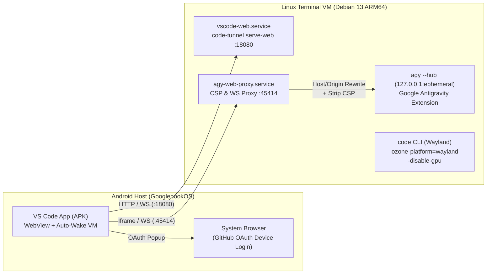

# VS Code on GooglebookOS (Android Laptop ARM64) — Complete Guide & Native APK

This repository contains the complete, step-by-step technical guide, Linux VM automation scripts, and the native Android wrapper application (**APK**) to run **Visual Studio Code (`arm64`)** on **GooglebookOS / Android Laptop**, including:

- **Native Terminal Launch (`code`)** via Wayland with VirGL GPU fallback fixes.
- **Native Android App (`VSCode-debug.apk`)** in the Android app drawer that automatically wakes up the Linux VM and renders VS Code in an edge-to-edge native window.
- **Persistent GitHub & Microsoft Authentication** across reboots (including 8-digit OAuth Device Code popup handling).
- **Google Antigravity Extension (`google.google-antigravity`) Support** inside the native Android APK via a transparent local CSP/WebSocket proxy.
- **Unattended APT Auto-Updates** with a `DPkg::Post-Invoke` hook that preserves all patches across updates.

---

## System Architecture



---

## Repository Structure

```text
.
├── README.md                              # Complete step-by-step documentation
├── VSCode-debug.apk                       # Ready-to-install Android APK
├── scripts/
│   ├── setup-vm.sh                        # Automated setup script for the Debian ARM64 VM
│   ├── agy_web_proxy.js                   # HTTP + WebSocket proxy for Google Antigravity
│   └── patch-antigravity-extension.py     # Patcher for the Google Antigravity extension
└── app/                                   # Android Studio / Gradle source code for the APK
    ├── build.gradle.kts
    └── src/main/
        ├── AndroidManifest.xml
        └── java/com/oft3r/vscode/
            ├── MainActivity.kt            # Fullscreen WebView + OAuth multi-window support
            ├── LauncherViewModel.kt       # Connection state machine
            └── ServerConnectionManager.kt # Port polling + Terminal VM wakeup
```

---

## Step-by-Step Technical Breakdown

### Step 1: Installing VS Code ARM64 & Microsoft's Official APT Repository

On GooglebookOS, the Linux development environment runs inside a **Debian 13 (`trixie`) ARM64** virtual machine.

1. Download the official `.deb` package for `arm64`:
   ```bash
   curl -L "https://code.visualstudio.com/sha/download?build=stable&os=linux-deb-arm64" -o /tmp/vscode-arm64.deb
   ```
2. Install `gpg` (required so the post-install script does not leave `/usr/share/keyrings/microsoft.gpg` empty) and install the package:
   ```bash
   sudo apt-get update && sudo apt-get install -y gpg wget apt-transport-https
   sudo apt-get install -y /tmp/vscode-arm64.deb
   ```
3. Verify the official signing key and APT source at `/etc/apt/sources.list.d/vscode.sources`:
   ```bash
   wget -qO- https://packages.microsoft.com/keys/microsoft.asc | gpg --dearmor > /tmp/microsoft.gpg
   sudo install -D -o root -g root -m 644 /tmp/microsoft.gpg /usr/share/keyrings/microsoft.gpg
   ```

---

### Step 2: Running `code` from the Terminal (Wayland & GPU Fix)

When launching `code` inside the VM, Electron defaults to X11 (`Xwayland`) and attempts to initialize hardware acceleration via `virgl`. Because the host compositor does not expose 3D VirGL contexts to Electron, the window either crashes or renders blank.

**Solution:**
1. Pass `--ozone-platform=wayland --disable-gpu` in `/usr/share/code/bin/code` (taking care **not** to run `sed -i` directly on `/usr/bin/code`, which would break the relative symlink `/usr/bin/code -> /usr/share/code/bin/code` used to locate `/usr/share/code/code`):
   ```bash
   sudo ln -sf /usr/share/code/bin/code /usr/bin/code
   sudo sed -i 's/"$ELECTRON" "$CLI" "$@"/"$ELECTRON" "$CLI" --ozone-platform=wayland --disable-gpu "$@"/g' /usr/share/code/bin/code
   ```
2. Add the flags to `~/.config/code-flags.conf`:
   ```ini
   --ozone-platform=wayland
   --disable-gpu
   --password-store=basic
   ```

---

### Step 3: Persisting GitHub & Microsoft Login Sessions

Inside the headless VM, there is no unlocked GNOME Keyring or KWallet daemon by default. Without explicit configuration, VS Code stores OAuth tokens in volatile memory and logs out on every restart.

**Solution:**
Configure `~/.vscode/argv.json` to use the persistent `basic` password store:
```json
{
    "enable-crash-reporter": true,
    "password-store": "basic"
}
```

---

### Step 4: Automatic Updates (`unattended-upgrades`) & Self-Healing Hook

To ensure VS Code updates automatically via APT without overwriting our Wayland flags in `/usr/share/code/bin/code`:

1. Allow the Microsoft APT origin in `/etc/apt/apt.conf.d/51unattended-upgrades-vscode`:
   ```apt
   Unattended-Upgrade::Origins-Pattern {
       "origin=code stable,label=code stable";
   };
   ```
2. Add a post-invoke hook in `/etc/apt/apt.conf.d/99vscode-wayland-fix` that automatically re-applies the flags and restarts the background web service whenever `code` is upgraded:
   ```apt
   DPkg::Post-Invoke {
       "if [ -f /usr/share/code/bin/code ] && ! grep -q -- '--ozone-platform=wayland' /usr/share/code/bin/code; then sed -i 's/\"$ELECTRON\" \"$CLI\" \"$@\"/\"$ELECTRON\" \"$CLI\" --ozone-platform=wayland --disable-gpu \"$@\"/g' /usr/share/code/bin/code; systemctl try-restart vscode-web.service >/dev/null 2>&1 || true; fi";
   };
   ```

---

### Step 5: Persistent Background Server (`vscode-web.service`)

To allow the Android APK to open instantaneously without launching a terminal window, we configure `code-tunnel serve-web` as a systemd service at `/etc/systemd/system/vscode-web.service`:

```ini
[Unit]
Description=Visual Studio Code Web Server for Android App
After=network.target

[Service]
Type=simple
User=droid
WorkingDirectory=/home/droid
Environment="VSCODE_AGENT_FOLDER=/home/droid/.vscode-server"
ExecStart=/usr/share/code/bin/code-tunnel serve-web --host 0.0.0.0 --port 18080 --without-connection-token --accept-server-license-terms
Restart=always
RestartSec=2

[Install]
WantedBy=multi-user.target
```

---

### Step 6: Native Android APK & GitHub Device Code Authentication

The native Android project (`com.oft3r.vscode`) provides a dedicated icon in the GooglebookOS launcher and handles three critical tasks:

1. **Auto-Wake Linux VM (`ServerConnectionManager.kt`):**
   Polls `http://localhost:18080`. If the VM is asleep, it fires an explicit intent to `com.android.virtualization.terminal` in the background and waits until the server responds before transitioning smoothly into the editor.
2. **GitHub OAuth Device Flow (`MainActivity.kt`):**
   In `serve-web` mode, signing into GitHub generates an **8-character Device Code** inside a VS Code modal and opens `https://github.com/login/device` in a popup (`window.open`).
   - If the WebView navigates away in the same tab, the modal containing the 8-digit code disappears.
   - Our `WebView` enables `setSupportMultipleWindows(true)` and intercepts external links via `WebChromeClient.onCreateWindow`, opening `https://github.com/login/device` in the external browser while keeping the VS Code modal (and its *"Copy & Continue to GitHub"* button) visible inside the app.

---

### Step 7: Enabling the Google Antigravity Extension in the APK

When running VS Code via `code` in the terminal, the **Google Antigravity** (`google.google-antigravity`) extension works out of the box. However, inside the APK (`serve-web`), two security restrictions blocked the Antigravity sidebar:

1. **Loopback-only binding (`127.0.0.1`):** The extension spawns `~/.gemini/bin/agy --hub --hub-port=<random_port>`, which binds strictly to `127.0.0.1` inside the VM and is unreachable from the Android host WebView unless proxied.
2. **Strict CSP (`Content-Security-Policy`):** In web mode, VS Code renders extension webviews inside a `https://*.vscode-cdn.net` parent frame, whereas `agy --hub` returns `frame-ancestors 'self' http://localhost:* vscode-webview:`. The Android WebView blocked the iframe due to the CSP mismatch.

**Solution:**
1. **`agy-web-proxy.service` (`scripts/agy_web_proxy.js`):**
   A lightweight Node.js proxy listening on `0.0.0.0:45414` that reads the active ephemeral port from `/tmp/agy_hub_port.txt`, forwards HTTP requests and WebSocket upgrades to `127.0.0.1:<port>`, rewrites `Host` and `Origin` headers so the hub accepts the connection, and strips `content-security-policy` and `x-frame-options` headers.
2. **Extension Patch (`scripts/patch-antigravity-extension.py`):**
   Patches `extension.js` of every installed Antigravity version (both the readable `<= 1.10.x` build and the minified `>= 1.11.x` build) so it records its dynamically allocated port to `/tmp/agy_hub_port.txt` and points the webview `effectiveUrl` to `http://localhost:45414`.
3. **Auto Re-Patch on Extension Updates (`agy-extension-patch.path`):**
   Extension updates install a fresh, unpatched copy (e.g. `google.google-antigravity-1.11.0`), which brings back the original CSP error. A systemd `.path` unit watches `~/.vscode-server/extensions` and `~/.vscode/extensions` and runs the patcher automatically whenever they change. After an update, simply reload the VS Code window.

---

## Quick Installation (Automated)

1. Run the automated setup script inside the Linux Terminal VM:
   ```bash
   chmod +x scripts/setup-vm.sh
   ./scripts/setup-vm.sh
   ```
2. Install `VSCode-debug.apk` from the Android Files app.

---

## Building the APK from Source (ARM64 VM)

To compile the APK yourself inside the Debian ARM64 VM (redirecting caches to the fast local `ext4` filesystem and using the native ARM64 `aapt2` binary):

```bash
mkdir -p ~/.cache/projects/vscode-launcher
./gradlew assembleDebug --project-cache-dir ~/.cache/projects/vscode-launcher/.gradle
```
